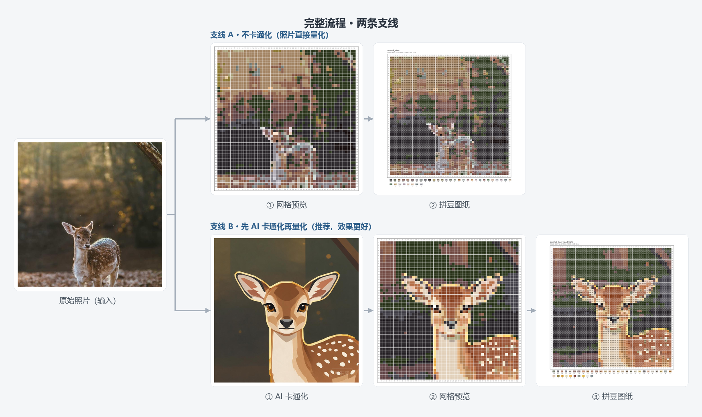

# Bead Studio — Perler Bead Pattern Generator

> Turn photos / cartoon images into **MARD palette** perler bead patterns.
> One-click desktop GUI, built-in AI cartoonization, and pure-numpy pixelization — zero heavy dependencies for the core pipeline.

**🎯 Illustrated manual** (pick one, same content):
- [manual.md](docs/manual.md) — readable directly on GitHub
- [manual.html](docs/manual.html) — download & double-click to open in browser, nicer styling

Full workflow at a glance:



---

## Features

- **One-click generation**: image → bead pattern (with color codes) + grid preview + JSON color matrix
- **AI cartoonization**: multimodal LLM understanding + Doubao SeedDream image-to-image, turning photos into clean cartoon images
- **Manual editing**: paint / erase / eyedropper / lasso / batch recolor / undo-redo
- **Pure-numpy core**: quantization and pixelization with zero torch / opencv / scipy dependency
- **Three pixelization methods**: PixelOE (contrast-aware) / DPID (detail-preserving) / AREA (area interpolation)

---

## Quick Start

### Option 1: Prebuilt binary (recommended, no environment needed)

1. Download `dist/BeadStudio/BeadStudio.exe`
2. Double-click to run

### Option 2: Run from source

```powershell
pip install numpy pillow PySide6 requests openai pyyaml

# Launch the desktop GUI
python bead_studio.py
```

> AI cartoonization is optional — configure your API key in "⚙️ Settings" first (see `docs/manual.html`, Section 3).

---

## Project Structure

```
├── bead_studio.py            # Desktop GUI main program (PySide6)
├── run_quantize.py           # Quantization entry (CLI)
├── core/                     # Core library
│   ├── quantize.py           # Quantization core (layered decision + island cleanup)
│   ├── pixelize.py           # Pixelization methods (pixeloe / dpid / area)
│   ├── bead_chart.py         # Bead pattern renderer (PNG)
│   ├── edit.py               # Grid editing
│   ├── palette_loader.py     # Palette loading + sRGB→Lab + ΔE76
│   ├── pipeline.py           # LLM understanding + SeedDream cartoonization pipeline
│   ├── seedream.py           # SeedDream client
│   ├── llm_client.py         # Generic LLM client (OpenAI-compatible, multi-provider)
│   ├── settings_dialog.py    # API settings dialog
│   └── ...
├── palettes/mard.csv         # MARD 221-color palette
├── samples/                  # Sample images
├── docs/
│   ├── manual.html           # Illustrated manual
│   └── assets/               # Manual images
└── outputs/                  # Output directory (git-ignored)
```

---

## CLI Usage

```powershell
# Minimal command (default 52×52)
python run_quantize.py --grid 52

# Change grid size + output suffix
python run_quantize.py --grid 64 --out-suffix _g64
```

### Common Options

| Option | Default | Description |
|--------|---------|-------------|
| `--grid N` | 52 | Grid side length (16–104) |
| `--image PATH` | — | Input image |
| `--supersample N` | 1 | Supersampling factor (recommend 4) |
| `--ss-strategy` | `vote` | Downsampling strategy: `vote` / `darkest` / `line_aware` |
| `--line-detect` | off | Enable line detection |
| `--line-method` | `canny` | `canny` / `multiscale` / `local` / `hybrid` / `frangi` |
| `--min-island-size N` | 2 | Small-island cleanup threshold |
| `--cleanup-min-contrast F` | 20.0 | Cleanup contrast threshold (ΔE) |

> For full options, run `python run_quantize.py --help`.

---

## Configuration

API keys are **not** stored in the repo: real keys live in `.env` (git-ignored); `config.yaml` only keeps `env:ARK_API_KEY` / `env:LLM_API_KEY` references.

> First run: copy `.env.example` to `.env` and fill in your Volcengine Ark + LLM keys.

- **Ark (Doubao)**: cartoonization via `doubao-seedream-5-0-pro`, inpainting via `doubao-seededit-3.0-t`
- **LLM**: defaults to `MiniMax-M3` (native multimodal); switchable to codexcn / openai / anthropic / gemini / qwen and other OpenAI-compatible endpoints

---

## Algorithm Overview

### Pixelization methods (`core/pixelize.py`)

| Method | Principle | Characteristics |
|--------|-----------|-----------------|
| **PixelOE** | Contrast-aware outline expansion + contrast-aware downscaling | Sharpest outlines, best detail (pure-numpy port, see credits) |
| **DPID** | Detail-preserving downscaling (SIGGRAPH Asia 2016) | Weights pixels by deviation from reference color; sharp, detailed |
| **AREA** | Area interpolation (cv2.INTER_AREA) | Simple, fast, anti-aliased, soft |

### Quantization pipeline (`core/quantize.py`)

```
Image → [line detection] → 4x supersample → layered color decision → downscale → island cleanup → result
```

- **Layered decision**: line → outline → detail → naive vote, selecting colors by priority
- **Adaptive line color**: never hardcodes "line = black"; picks color by max ΔE from background
- **Island cleanup**: ΔE-aware — keeps isolated dark pixels (eyelashes/pupils), merges noise
- **Color space**: unified CIE Lab + ΔE76

---

## Known Limitations

- **A 52×52 grid can't hold full whiskers**: 1px-wide whiskers are lost after downscaling; raise grid to 64/80 (exceeds a single physical board)
- **Outline thickness vs. "cleanliness" tradeoff**: `line_aware` thickens outlines but introduces more black pixels
- **Frangi can't detect black lines** (by design), not recommended for this use case
- **Packaged binary ~256 MB** (includes Qt runtime)

---

## AI Tools Disclosure

The following AI tools assisted coding, design, and documentation during development. Core algorithms are self-developed or hand-ported from open-source implementations.

### Development Assistance

| Tool / Model | Purpose |
|--------------|---------|
| WorkBuddy (Tencent) | Primary dev environment: code generation/refactoring, GUI polish, packaging debugging, docs |
| DeepSeek-V4-Pro | Reasoning assistance for code logic & algorithm alignment (e.g., numpy reimplementation of torch semantics) |
| MiniMax Code | Coding assistance, snippet generation & review |

### Runtime Generative Capabilities

| Model / Service | Purpose |
|-----------------|---------|
| MiniMax-M3 | Multimodal visual understanding (key features + cartoon style description) |
| Doubao SeedDream (Volcengine Ark) | Image-to-image cartoonization |
| Doubao SeedEdit (Volcengine Ark) | Inpainting (optional, watermark/object removal) |

> **Privacy**: all API keys live in local `.env` (ignored); images are only uploaded when the user explicitly clicks "Cartoonize".

---

## Credits

| Algorithm / Source | Purpose | License |
|--------------------|---------|---------|
| **PixelOE** — [KohakuBlueleaf/PixelOE](https://github.com/KohakuBlueleaf/PixelOE) | Pixelization (pixeloe), pure-numpy port, pixel-identical to the official torch implementation | Apache-2.0 |
| **DPID** — Weber et al., *Rapid, Detail-Preserving Image Downscaling*, SIGGRAPH Asia 2016 | Pixelization (dpid), numpy port from the official Matlab version | Academic paper |
| **cv2.INTER_AREA** — [OpenCV](https://opencv.org/) | Pixelization (area), area interpolation downscaling | Apache-2.0 |
| **MARD 221 palette** | Perler bead color system | — |

> PixelOE's contrast-aware outline expansion and contrast-aware downscaling are faithfully reimplemented in pure numpy (`core/pixelize.py`); DPID is ported from the official Matlab `dpid.m`. Special thanks to the original authors.

---

*README last updated: 2026-10-27 · 中文版见 [README.md](README.md)*
