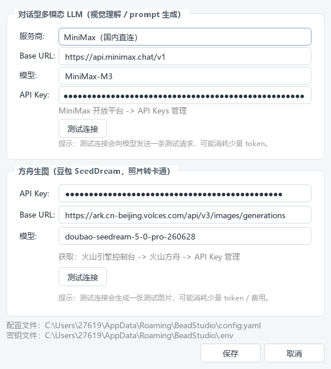
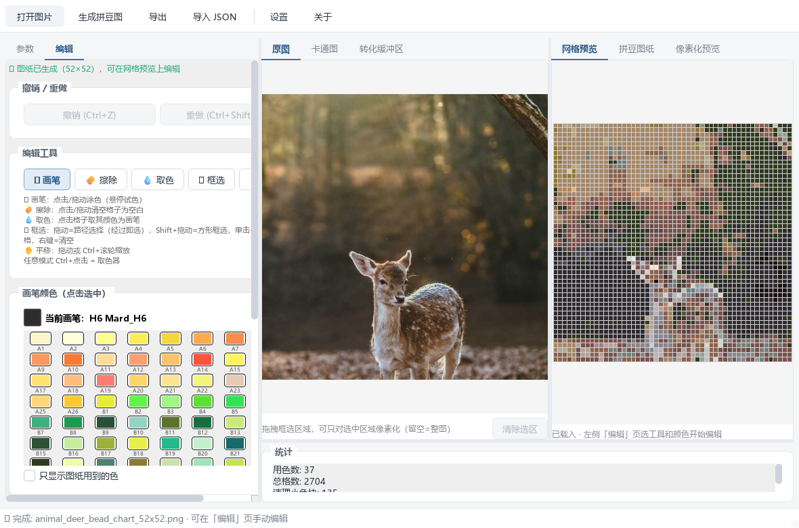

# Beadobe · 拼豆图纸生成器 — 操作手册

> 把照片 / 卡通图一键转换成可实际拼搭的 **MARD 色板**拼豆图纸。支持 AI 卡通化、手动编辑、参数调优与多种导出。

> 💡 本项目原名 *Bead Studio*，因同名项目过多改名为 **Beadobe**。所有名称、代码与可执行文件均已统一为 Beadobe。


*完整流程两条支线：同一张原始照片，不卡通化直接量化（A），或先 AI 卡通化再量化（B，推荐）。两张网格与图纸均与各自的输入源一一对应。*

---

## 目录

1. [安装与启动](#1-安装与启动)
2. [快速上手五步走](#2-快速上手五步走)
3. [卡通化（可选）](#3-卡通化可选需-api-key)
4. [手动编辑](#4-手动编辑)
5. [参数调优参考](#5-参数调优参考)
6. [导出与导入](#6-导出与导入)
7. [快捷键](#7-快捷键)
8. [常见问题](#8-常见问题)

---

## 1. 安装与启动

### 方式 A：直接运行打包版（推荐，开箱即用）

1. 拿到 `Beadobe` 文件夹（内含 `Beadobe.exe` 与 `_internal`）。
2. 双击 `Beadobe.exe` 即可启动，无需安装 Python。
3. 首次启动会在用户目录自动生成配置（`%APPDATA%\Beadobe`），不影响使用。

### 方式 B：源码运行（适合想改代码 / 用到最新功能）

```bash
# 1. 安装 Python 3.10+ 后安装依赖
pip install numpy pillow opencv-python PySide6 pyyaml requests

# 2. （可选，AI 卡通化需要）
pip install openai

# 3. 在项目目录启动
python beadobe.py
```

> 💡 缺失可选依赖时程序不会崩溃，会弹窗说明哪些功能不可用，其余功能照常工作。

---

## 2. 快速上手五步走

### 第 1 步 · 打开图片

点击左上角「**打开图片**」，或直接把图片**拖进窗口**。支持 JPG / PNG 等常见格式。

### 第 2 步 ·（可选）AI 卡通化

这里是一个**岔路口**，决定走哪条支线（见顶部流程图）：

- **支线 A · 不卡通化**：照片直接点「生成拼豆图纸」。优点是零成本、零等待、色彩最忠实；缺点是照片背景和光影杂色多，主体不够干净。
- **支线 B · 先卡通化**：点「**卡通化当前图片**」（需 API Key，见[第 3 节](#3-卡通化可选需-api-key)），完成后右侧自动切到「卡通图」Tab——此时再点「生成拼豆图纸」，**量化的就是卡通版**，色块干净、轮廓清晰、眼睛等关键细节保留更好。

> 💡 生成图纸永远以右侧当前所在的源图 Tab 为准（原图 / 卡通图 / 转化缓冲区）。想对比两条支线的效果，分别在两个 Tab 下各生成一次即可。

### 第 3 步 · 生成拼豆图纸

点左侧底部蓝色「**生成拼豆图纸**」按钮（或 `Ctrl+R`）。几秒后右侧会同时出现：

- **网格预览**——纯色块 + 网格线，用于对照摆豆；
- **拼豆图纸**——每格标注 MARD 色号，带行列号与底部图例，可打印照做；
- **像素化预览**——无网格线的成品效果，模拟拼豆烫化后的样子。

### 第 4 步 · 手动微调（可选）

切到左侧「**编辑**」页，用画笔 / 擦除 / 框选工具修整细节（见[第 4 节](#4-手动编辑)）。算法不是完美的——尤其是眼睛、胡须这类 1–2 格的关键细节，手动点几下往往效果最好。

### 第 5 步 · 导出

点「**导出**」（`Ctrl+S`），勾选需要的产物：

| 产物 | 用途 |
|------|------|
| 拼豆图纸 PNG | 打印出来，按色号逐格拼搭 |
| 网格预览 PNG | 屏幕对照，色块更直观 |
| 像素化预览 PNG | 分享 / 预览成品效果 |
| JSON 色号矩阵 | 二次开发（统计用豆量、生成加工文件） |

导出前可自定义文件名基名与输出目录。

---

## 3. 卡通化（可选，需 API Key）

卡通化分两步自动完成：**对话型 LLM 理解图片关键特征**（眼睛、耳朵、花纹位置）→ **豆包 SeedDream 图生图**转成干净色块的卡通风格。关键特征坐标会传给量化器，让眼睛、鼻线等细节在低网格下也能保留。



*工具栏「设置」→ 填入对话型 LLM 与方舟生图的 API Key，可点击「测试连接」验证*

1. 点工具栏「**设置**」，分别配置「对话型多模态 LLM」和「方舟生图」的 API Key（密钥保存在本地 `.env` 文件，不会上传）。
2. 点「测试连接」确认可用。注意：测试会发送真实请求，**可能消耗少量 token / 费用**。
3. 回到主界面，载入照片后点「**卡通化当前图片**」（约 1–2 分钟）。
4. 完成后卡通图出现在右侧「卡通图」Tab。**生成图纸以当前源图 Tab 为准**——停在「卡通图」Tab 再点「生成」，产出的网格与图纸就来自卡通版（即流程图中的支线 B）。

### 卡通化前后对比

同一张鹿照片，两条支线在 52×52 网格下的差异（对应顶部流程图）：

- **支线 A（直接量化）**：背景森林与光影被如实转成色块，主体轮廓偏碎，细节较模糊。
- **支线 B（先卡通化）**：AI 把画面简化成干净色块并突出面部特征，网格里鹿的眼睛、耳廓、斑点都清晰可辨，成品效果显著更好。

### 自定义 Prompt

「卡通化」分组里可填写自定义 Prompt 直接指定风格（例：*「清新可爱的卡通猫，白色短毛，半眯眼，干净色块」*），填了就跳过 LLM 自动描述。

> ⚠ 卡通化会调用云端 API 并产生费用；缺少 Key 时该功能不可用，但不影响本地量化生成图纸。

---

## 4. 手动编辑



*「编辑」页：撤销/重做、五种工具、221 色色板（点击选色）*

### 五种工具

| 工具 | 操作 |
|------|------|
| 🖌 画笔 | 点击 / 拖动涂色；在色板上**悬停**可实时预览改色效果，点击确认 |
| 🧽 擦除 | 点击 / 拖动把格子清空为空白 |
| 💧 取色 | 点击任意格子，把它颜色设为画笔色 |
| ⬚ 框选 | 拖动 = 路径选择；`Shift`+拖动 = 方形框选；单击 = 反选单格；右键 = 清空选择 |
| ✋ 平移 | 拖动平移画布；`Ctrl`+滚轮缩放 |

### 选中与批量改色

- 「**按颜色选中…**」弹出颜色列表面板（按用量排序），可多选；「**图上点选同色**」则在网格上点一格选中全部同色格。
- 选中后，用「**改为**」选目标色（色块 + 色号），点「应用」一键批量改色，也可直接在色板上点色确认。
- 加深 / 变浅 / 对比度三个滑条可对选中格子做实时颜色微调。
- 所有编辑支持 `Ctrl+Z` 撤销 / `Ctrl+Shift+Z` 重做，导出的永远是**编辑后的最终结果**。

### 框选区域生成

在「原图」/「卡通图」Tab 上直接拖拽即可框选区域（可拖边角微调），只对选中区域做量化——适合照片主体小、想放大细节的场景。选区会显示在「转化缓冲区」Tab。

---

## 5. 参数调优参考

默认参数（pixeloe + nearest）适合大多数图片。以下是最值得调的几项：

| 参数 | 默认 | 怎么调 |
|------|------|--------|
| Grid size | 52 | 16–104。越大细节越多，但豆板数量与工作量也增加。16/32 适合做挂件小图，52 对应一整块标准板，104 适合大幅作品 |
| 像素化方法 | pixeloe | **pixeloe**：轮廓干净、色块分明（推荐照片/卡通）；**area**：直接平均，最朴素；**dpid**：保留更多纹理；**SuperSample**：超采样+投票，可抢救细线条 |
| POE mode | nearest | center/contrast 增强对比；bicubic 更平滑；nearest 边缘锐利 |
| thickness | 3 | PixelOE 轮廓描边粗细，0 = 关闭。线条发虚可加到 4–5，太重可减 |
| 超采样（仅 SuperSample） | 4 / vote | 策略 **darkest** 保留深色描边（适合线稿），**line_aware** 配合线条检测抢救胡须等细线 |
| Min island size | 2 | 小于该面积的孤立色块会被清理；调大画面更干净，调小保留更多细节 |
| Cleanup ΔE | 20 | 清理时的色差阈值：与周围差异大于它的孤立块视为关键特征保留（如黑色瞳孔） |

> 💡 调参心法：先用默认生成看整体 → 眼睛/胡须细节丢了就开「线条检测」或提高 grid → 杂色太多就加大 Min island size。

---

## 6. 导出与导入

- **导出**（`Ctrl+S`）：四类产物按需勾选，统一文件名基名（默认取图片名或「图纸命名」框内容）。
- **导入 JSON**（`Ctrl+I`）：载入之前导出的色号矩阵，继续编辑或重新导出——图纸数据可以无损搬运。

---

## 7. 快捷键

| 快捷键 | 功能 |
|--------|------|
| `Ctrl+O` | 打开图片 |
| `Ctrl+R` | 生成拼豆图纸 |
| `Ctrl+S` | 导出 |
| `Ctrl+I` | 导入 JSON |
| `Ctrl+Z` / `Ctrl+Shift+Z` | 撤销 / 重做 |
| `Ctrl+A` | 全选格子 |
| `Ctrl`+滚轮 | 缩放画布（任意工具下） |
| `Ctrl`+点击 | 任意模式下临时取色 |

---

## 8. 常见问题

### 生成失败 / 按钮是灰的？

「生成」需要先打开图片；「卡通化」需要先配置 API Key 并联网。看底部状态栏提示即可定位。

### 眼睛、胡须等细节丢失？

三招依次尝试：① 提高 Grid size；② 像素化方法换 SuperSample + 线条检测（方法选 canny）；③ 切到编辑页手动画上去——往往最快。

### 色号在实物豆子里找不到？

所有色号来自 MARD 221 色色板（`palettes/mard.csv`），按色号采购即可。若某色缺货，可用批量改色换成近似色（编辑页「改为」）。

### 测试连接 / 卡通化报错？

先检查 Key 与网络；方舟接口偶尔限流，重试即可。测试连接本身会发真实请求并消耗少量 token。

### 想换色板？

把新色板做成 `code,name,hex` 格式的 CSV 替换 `palettes/mard.csv`（或改代码指向新文件）即可，量化器自动适配任意色数。

---

*Beadobe · 拼豆图纸生成器 · 操作手册 v1.1*
